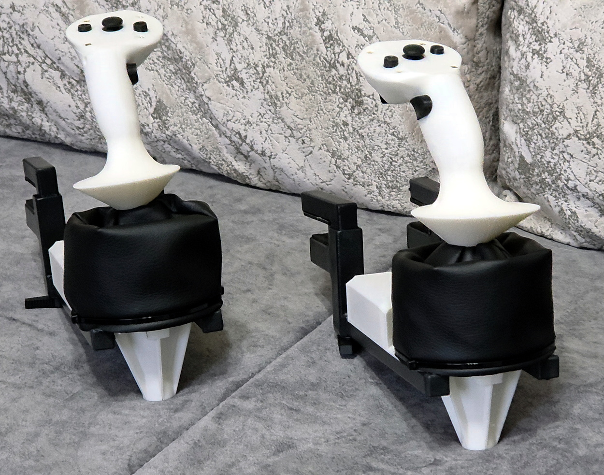

# HOSAS Joystick

Two-stick controller set (HOSAS — Hands On Stick And Stick) for space flight simulators.
Eight analog axes: six for ship motion, two for camera control. Grips are 3D-printed,
boards are single-sided and suitable for home fabrication by the laser toner transfer
method (LTTM), controllers are STM32 Blue Pill or Arduino Pro Micro.

This document is the current build reference. Separate assembly documentation does not
exist yet; unfinished items are marked `TODO` and listed in [Known gaps](#known-gaps).



Video walkthrough: `TODO — YouTube link`

---

## 1. Overview

| Input | Axes | Buttons |
|---|---|---|
| Right grip | 4 | 2 |
| Left grip | 4 | 2 |

| Parameter | Value |
|---|---|
| Controller, current build | STM32 Blue Pill (STM32F103C8T6), USB Custom HID |
| Controller, earlier builds | Arduino Pro Micro (ATmega32U4), supported |
| Axis sensing | Potentiometers → ADC (DMA on STM32) |
| Centering | Return spring |
| Fastening | Wood screws into printed bosses |
| Host interface | USB, no driver installation |
| Desk mount | Welded 20×20 / 15×15 mm steel tube, M8 bolts |

## 2. Repository layout

```
body/                               3D models and print layouts
  Joystick_Base_v0.4.f3d / .step        base, editable source + STEP
  joystick_handle_v0.6.f3d / .step      grip, editable source + STEP
  Base_Print_Layout.3mf                 slicer project, base parts
  Left_Handle_Print_Layout.3mf          slicer project, left grip
  Right_Handle_Print_Layout.3mf         slicer project, right grip
electronics/
  joystick_v4_left/                     KiCad project + joystick_v4-Cu.svg (copper artwork)
  joystick_v4_right/                    KiCad project + joystick_v4-Cu.svg (copper artwork)
firmware/
  Arduino/HOSAS/HOSAS.ino               Pro Micro sketch
  STM32/CJoy/                           STM32CubeIDE project (CJoy.ioc, Core, USB_DEVICE)
  STM32/prebuilt/CJoy.bin               compiled firmware, flash-ready
BOM.md                                Bill of materials
```

One KiCad project per hand. Editable CAD is Fusion 360 (`.f3d`); `.step` is provided for
other CAD systems. STL files are not published — export from the STEP.

## 3. Parts and tools

Bill of materials: [BOM.md](BOM.md).

Tools: 3D printer; laser printer and glossy paper; iron; etching chemicals; carbide drill
bits; soldering iron and hot air; multimeter; crimp tool; ST-Link V2 for STM32 flashing.

## 4. Build

Sequence: print → PCB → assembly → firmware → verification. Test after each stage, not
after final assembly; faults are cheaper to find early.

### 4.1 Printing

Print the four slicer projects in `body/` — 2x base, left grip, right grip. Parts are already
arranged with supports. Scale 100 %: potentiometer seats and screw bosses are
dimension-critical.

| Parameter | Value |
|---|---|
| Material | eSun PLA+ |
| Nozzle | 0.4 |
| Slicer | Orca Slicer v2.4.1 |

### 4.2 PCB fabrication (LTTM)

**Current PCB design is for STM32 only.**
`TODO add Arduino Pro Micro PCB design`
Artwork: `electronics/joystick_v4_*/joystick_v4-Cu.svg` (copper layer).
Project files: `.kicad_pro`, `.kicad_sch`, `.kicad_pcb` — KiCad 9.0.

Home fabrication is recommended for a first prototype: a fab-house order adds weeks of
lead time before a layout error becomes apparent.

1. **Print the artwork** on glossy paper with a laser printer, **it is already mirrored**, at 1:1 scale.
   Verify the scale against a known 2.54 mm header pitch before transfer.
2. **Prepare the laminate:** wet 1000-grit abrasive, then degrease with alcohol.
3. **Transfer:** iron near maximum (cotton setting), toner side down, about two minutes
   with firm, even pressure.
4. **Remove the paper:** soak in hot soapy water for 30 minutes, then roll the paper off
   with the fingers under water. Toner remaining on copper indicates the correct
   temperature; smeared toner means too hot, toner left on paper means too cold.
5. **Etch:** 100 ml hydrogen peroxide + 30 g citric acid + 5 g sodium chloride. Keep the
   vessel on a water bath or other mild heat source and agitate periodically. Clearing of
   the copper between tracks takes 20–30 minutes.
6. **Finish:** strip the toner with fine abrasive, drill with carbide bits (standard bits
   tear the tracks), trim the board to size.
7. **Tin and solder:** rosin or no-clean flux only; acid fluxes are not acceptable.
   Through-hole components from the solder side, SMD on the component side with hot air.
   A double-sided board is made as two single-sided boards joined by wire links.
8. **Verify:** check every track for continuity and every adjacent pair for shorts with a
   multimeter. Use crimped DuPont connectors for detachable wiring.

Read [Safety](#5-safety) before etching.

### 4.3 Mechanical assembly

Detailed instructions: `TODO`. Current sequence:

1. Mount the potentiometers in their designed seats and check alignment over the full
   travel of each axis before fixing them.
2. Fasten the boards and mechanical parts with wood screws into the printed bosses.
   Plastic threads tolerate limited torque; overtightening breaks them.
3. Fit the return spring under tension. Confirm free travel and reliable centering of
   both axes before closing the grip.
4. Wire the axes and buttons according to the schematic, then verify direction and
   endpoint values on the host before final closure.

### 4.4 Firmware

**Arduino Pro Micro** — `firmware/Arduino/HOSAS/HOSAS.ino`

Open the sketch in Arduino IDE, select board `Arduino Micro`, install 
https://github.com/MHeironimus/ArduinoJoystickLibrary, upload, then verify in the host joystick panel.

**STM32 Blue Pill** — `firmware/STM32/CJoy/`

STM32CubeIDE project generated from `CJoy.ioc`. Target STM32F103C8Tx, linker script
`STM32F103C8TX_FLASH.ld`. USB class: Custom HID; the report descriptor is defined in
`USB_DEVICE/App/usbd_custom_hid_if.c`. Axes are read by ADC with DMA
(`Core/Src/adc.c`, `Core/Src/dma.c`), buttons through GPIO.

- Build: import the project into STM32CubeIDE and build.
- Flash without building: `firmware/STM32/prebuilt/CJoy.bin`.
- Upload: ST-Link V2 over SWD (SWDIO, SWCLK, GND, 3V3), or the factory USART1 bootloader
  with BOOT0 = 1 using STM32CubeProgrammer. Flash address `0x08000000`.
- Axis limits, inversion, and deadzone: `TODO — document the constants in Core/Src/main.c`.

The Blue Pill costs about half as much as the Pro Micro and offers higher performance;
the flashing procedure is more involved.

### 4.5 Verification and binding

1. Confirm that both sticks enumerate as separate USB devices.
2. Open the host joystick panel (Windows: `joy.cpl`) and check all axes and all
   buttons: full range, stable center, no jitter, correct direction.
3. Assign the axes in the simulator, invert where required, apply a deadzones,
   and set response curves for the translation axes.

## 5. Safety

Respiratory and eye protection are required when abrading copper laminate and when
etching; work in a ventilated area. Welding and abrasive cutting require the corresponding
protective equipment.

Spent etchant must not be discharged into the drain. Neutralise it with iron filings or
steel offcuts; decant only the clear liquid after neutralisation and dispose of the solid
residue as household waste.

The project is provided "as is", without warranty. Fabrication and use are undertaken at
the operator's own risk.

## 6. Desk mount

The mount holds the grip at elbow height and leaves the keyboard and mouse area free.
Construction: 20×20 and 15×15 mm steel tube, cut, welded, roller-painted, with felt pads on
all desk contact surfaces to prevent slipping and scratching.

Cut list and drawings: `TODO — not published yet`.

## Known gaps

- Step-by-step mechanical assembly instructions.
- Desk mount cut list and drawings.
- Third-revision defects and planned changes.

Corrections and additions are welcome through Issues.

## License

| Scope | License |
|---|---|
| Firmware (`firmware/`) | Apache License 2.0 |
| CAD models, PCB designs, documentation, media | CC BY 4.0 |

Copying, modification, and redistribution, including commercial use, are permitted.
Firmware redistribution requires retention of the LICENSE and NOTICE files and a notice
stating that files were modified. Redistribution of design files requires credit, a link
to this repository, a link to the license, and an indication of changes.

> Based on the HOSAS Joystick project by Aleh-Zamzhytski and Kommande —
> https://github.com/Aleh-Zamzhytski/hosas-joystick (hardware: CC BY 4.0, firmware: Apache-2.0).

Attribution on physical builds, photographs, and videos is appreciated but not required.
Third-party components under `firmware/STM32/CJoy/Drivers` and `Middlewares` retain their
own licenses (see the `LICENSE.txt` files in those directories).